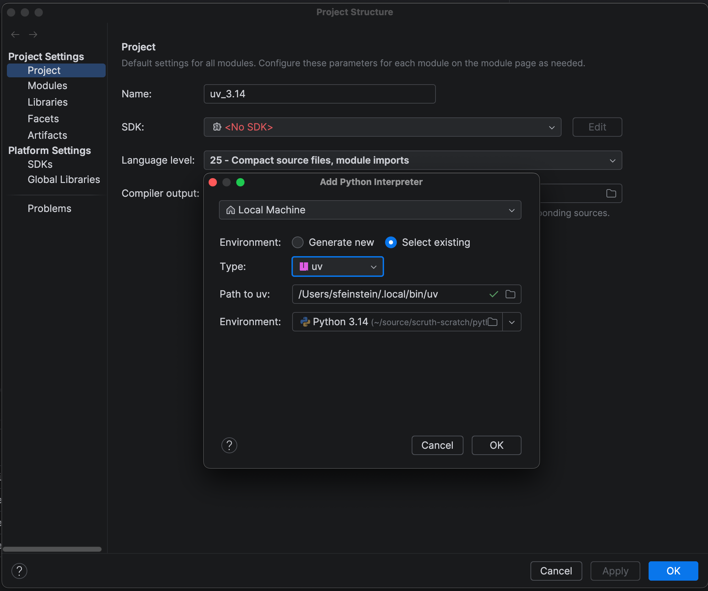

# Overview
Basic project initialized by `uv init --python 3.14`, for learning!

Made manual changes as well.

# IntelliJ
Can easily use the generated virtual environment by going into `Project Structure... > Platform Settings > SDKs.

Add New SDK with the plus icon and then choose `Select existing` and set Type to `uv` (then `OK`).

Pick the environment and it should update the Project to use it correctly.



# Basics
Update dependencies via `uv sync --upgrade`.

Linting and formatting via `ruff format` and `ruff check`.
There is no pre-commit hook for this, currently.

The virtual env should automatically be activated based on the presence of `.venv`.

Run scripts directly or via `uv run main.py`, etc. 

The `.python-version` specifies a minor release but not the dot level.
To upgrade the dot level to latest:
```shell
uv python upgrade 3.14
uv python install --reinstall
```
